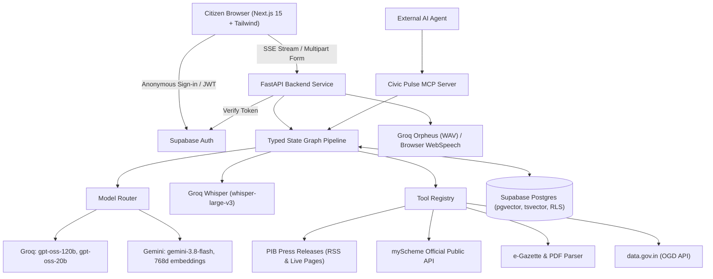
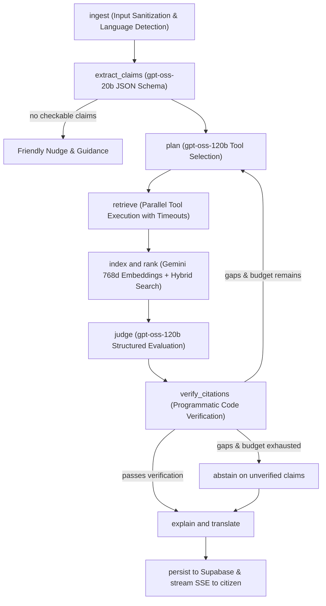

# Jan-Pulse — Civic Intelligence and Verification Engine

Jan-Pulse is an open-source civic verification engine where Indian citizens can verify viral forwards, check government scheme eligibility from official rules, and understand gazette notifications in plain language. Every statement cites an official government source fetched at runtime with exact timestamps, and the system abstains with "Can't verify" rather than guessing.

---

## 1. System Architecture



---

## 2. Pipeline Execution Flow



---

## 3. Features & Official Data Sources

| Feature | What It Does | Official Sources Used |
|---|---|---|
| **F1. Forward Checker** | Validates viral WhatsApp/social media messages (text, image, audio) and outputs Supported, Contradicted, Partly Supported, or Can't Verify. | Press Information Bureau (PIB) RSS (`pib.gov.in`), myScheme (`myscheme.gov.in`), Central Gazettes. |
| **F2. Scheme Eligibility Wizard** | Matches citizen circumstances against official scheme criteria with adaptive questions, original wording, and documents required. | myScheme official REST API (`api.myscheme.gov.in`) with live eligibility markdown and document catalogs. |
| **F3. Notification Explainer** | Breaks down official government gazette circulars or PDFs into who is affected, effective dates, deadlines, penalties, and action steps. | The Gazette of India (`egazette.gov.in`) & allowlisted ministry publications. |
| **F4. Voice & Multilingual** | Speech-to-text voice notes in Hindi/English with editable transcripts; audio readout in English via Groq Orpheus and regional languages via device speech. | Groq `whisper-large-v3`, Groq `canopylabs/orpheus-v1-english`, Web Speech API. |
| **F5. Provenance & Evidence Trail** | Full disclosure of all tool calls, source URLs, HTTP status codes, and execution latencies in milliseconds. | Logged in Supabase `trace_events`. |
| **F6. Security & Data Control** | Prompt injection neutralization, SSRF protection against internal IPs, and one-click data deletion. | In-memory boundaries, allowlisted domains, `/v1/me/history`. |
| **F8. Public Verdict Cards** | Shareable card link exposing only the verified verdict, explanation, and official citations. | Public endpoint `/v1/share/{share_id}`. |
| **F9. Civic Pulse MCP Server** | Model Context Protocol server exposing `check_claim`, `find_schemes`, and `explain_notification`. | JSON-RPC MCP Tools. |

---

## 4. Models and Routing Strategy

- **Groq `openai/gpt-oss-20b`**: High-speed claim extraction, input routing, and JSON-schema classification.
- **Groq `openai/gpt-oss-120b`**: Multi-step planning, evidence judging, and scheme fact extraction.
- **Google Gemini `gemini-3.8-flash`**: Long context documents, full gazette notifications, and automatic fallback for Groq rate limits.
- **Google Gemini `models/gemini-embedding-001`**: 768-dimensional dense vector embeddings stored in Supabase pgvector.
- **Groq `whisper-large-v3`**: Accurate speech-to-text with language code hints (`hi`, `en`, `ta`, `te`, `bn`, `mr`).
- **Groq `canopylabs/orpheus-v1-english`**: Low-latency English WAV voice synthesis.

---

## 5. Security & Trust Architecture

1. **Prompt Injection Defense**: All user inputs and scraped web texts are enclosed within strict `<untrusted_external_content>` tags. System instructions explicitly prohibit executing embedded commands or instructions. Heuristic screening logs security alerts to `trace_events`.
2. **SSRF Guardrails**: User-supplied URLs are strictly validated against an allowlist of Indian government domains (`.gov.in`, `.nic.in`). Private and localhost IP networks (`127.0.0.0/8`, `10.0.0.0/8`, `192.168.0.0/16`, `169.254.0.0/16`) are blocked at network inception.
3. **Programmatic Citation Verification**: The judge model's citations are verified in Python code before being returned to the user. If the cited continuous span is missing from the stored chunk, the citation is rejected and the verdict falls back to `cannot_verify`.
4. **Data Minimization**: Jan-Pulse does not require or collect Aadhaar, phone numbers, or residential addresses.

---

## 6. Quickstart & Local Setup

### Prerequisites
- Python 3.11+ / 3.12 / 3.14
- Node.js 18+ / 20+ / 24+
- Supabase Project with `vector` and `pg_trgm` extensions

### 1. Environment Configuration
Create `.env` based on `.env.example`:
```env
SUPABASE_URL=https://<your-project>.supabase.co
SUPABASE_ANON_KEY=<your-anon-key>
SUPABASE_URI=postgresql://postgres.<project>:<password>@aws-0-ap-south-1.pooler.supabase.com:5432/postgres
GROQ_API=gsk_...
GEMINI_API=AQ...
```

### 2. Apply Database Migrations
Execute the SQL migration in `backend/migrations/001_initial_schema.sql` inside your Supabase project's SQL Editor (or via Supabase CLI).

### 3. Start the FastAPI Backend
```bash
# In one terminal
cd backend
python -m uvicorn app.main:app --host 127.0.0.1 --port 8000 --reload
# Or run: start_backend.bat
```

### 4. Start the Next.js Frontend
```bash
# In another terminal
cd frontend
npm run dev
# Or run: start_frontend.bat
```
Open [http://localhost:3000](http://localhost:3000) in your browser.

---

## 7. Limitations & Ethical Notice

- **Advisory Guidance**: Jan-Pulse is an unofficial public information tool. Verdicts and eligibility calculations are automated guidance based on published records, not official government decisions.
- **Audio Output**: Server-side Groq Orpheus voice supports English only. Regional languages (Hindi, Tamil, etc.) use the client device's browser speech synthesis when available, and the Listen button is safely hidden if the device lacks a matching voice.
- **No Deepfake Models**: Per track specifications, Jan-Pulse does not claim to detect synthetic audio/video deepfakes; it verifies factual claims against textual official records.

