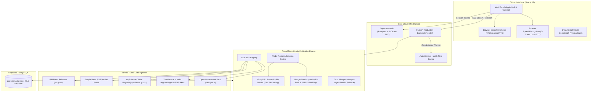
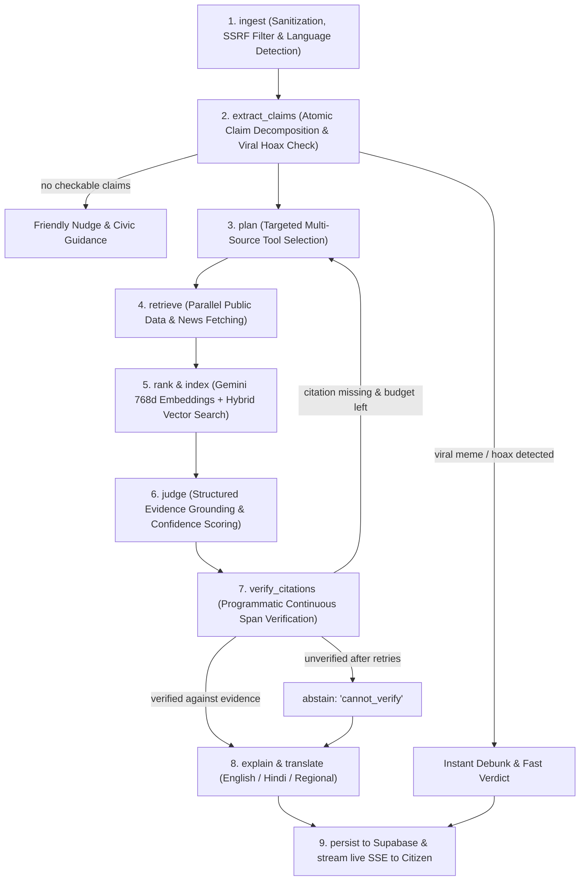

# Jan-Pulse — Civic Intelligence and Verification Engine

[](https://janpulse.lalankr.in)
[](https://janpulse.onrender.com/health)
[](LICENSE)

**Jan-Pulse** is an open-source civic intelligence engine empowering Indian citizens to verify viral WhatsApp forwards, discover public scheme eligibility from official criteria, and decode complex government gazettes in plain language. Every verdict cites authoritative public sources fetched at runtime with exact timestamps, strictly adhering to an automated *"Cannot verify"* policy rather than guessing or hallucinating.

---

## 1. System Architecture



---

## 2. Pipeline Execution Flow



---

## 3. Core Features & Capabilities

| Feature | Description | Authoritative Sources |
|---|---|---|
| **F1. Forward Checker** | Validates viral claims (text, screenshot OCR, voice note) and assigns grounded labels: `supported`, `contradicted`, `partly_supported`, or `cannot_verify`. | Press Information Bureau (`pib.gov.in`), Google News RSS wires, Ministry Gazettes. |
| **F2. Scheme Eligibility Wizard** | Matches citizen circumstances (age, occupation, state, caste, income) against official scheme criteria with required document checklists. | myScheme official REST registry (`myscheme.gov.in`). |
| **F3. Gazette Explainer** | Decodes central circulars, acts, and statutory PDF orders into plain language: who is affected, deadlines, penalties, and next steps. | The Gazette of India (`egazette.gov.in`) parsed via RAG chunking. |
| **F4. Zero-Token Speech (TTS/STT)** | Uses browser-native Web Speech APIs for instant client-side readouts and live voice note transcription with 0 server token consumption. | Client Web Speech API (English & Hindi) + Groq Whisper fallback. |
| **F5. Social Share Cards** | Dynamic 1200×630 server-rendered OpenGraph cards that automatically unfurl on WhatsApp, Twitter/X, Telegram, and LinkedIn. | Next.js `ImageResponse` with real-time colored verdict badges. |
| **F6. Background Engine Warmer** | Pings the backend `/health` endpoint silently upon page load with a corner status pill, eliminating cold-start latency before the user submits a query. | Real-time health check & session-aware caching. |
| **F7. Provenance & Evidence Trail** | Full disclosure of all tool calls, source URLs, HTTP status codes, and execution latencies in milliseconds. | Tracked via `trace_events` in Supabase. |
| **F8. Civic Pulse MCP Server** | Implements the Model Context Protocol (MCP) exposing `check_claim`, `find_schemes`, and `explain_notification` to external agents. | Native JSON-RPC MCP Tools. |

---

## 4. Models & Routing Strategy

- **Groq `llama-3.1-8b-instant`**: Ultra-fast 8B parameter model (~150ms latency) handling claim extraction, planning, and structured evidence evaluation with low token overhead.
- **Google Gemini `models/gemini-3.8-flash`**: High-context document processing, multimodal OCR for scanned circulars, and comprehensive fallback.
- **Google Gemini `models/gemini-embedding-001`**: 768-dimensional dense vector embeddings stored in Supabase `pgvector`.
- **Groq `whisper-large-v3`**: High-accuracy speech-to-text fallback when browser `SpeechRecognition` is not supported.

---

## 5. Repository Structure

```
JanPulse/
├── frontend/               # Next.js 15 App Router Web Client
│   ├── src/
│   │   ├── app/            # Pages: /, /explain, /schemes, /about, /account, /share/[id]
│   │   │   ├── opengraph-image.tsx       # Root 1200x630 social banner
│   │   │   └── share/[id]/
│   │   │       ├── page.tsx              # Server-rendered metadata for crawlers
│   │   │       ├── opengraph-image.tsx   # Dynamic verdict banner for WhatsApp/X
│   │   │       └── ShareCardClient.tsx   # Interactive client component
│   │   ├── components/     # Apple HIG UI components, AudioPlayer, BackendWarmer
│   │   └── lib/            # api.ts, supabase.ts, historyStore.ts
│   ├── package.json
│   └── tailwind.config.ts
│
├── backend/                # FastAPI Production Backend Service
│   ├── app/
│   │   ├── graph/          # Typed state graph & pipeline execution
│   │   ├── llm/            # ModelRouter, schemas, guardrails, and prompts
│   │   ├── rag/            # Embedder, chunker, gazette RAG, and verifier
│   │   ├── tools/          # PIB, myScheme, e-Gazette, Google News RSS, data.gov.in
│   │   ├── voice/          # Whisper STT & Orpheus TTS fallbacks
│   │   ├── config.py       # Pydantic environment configuration
│   │   ├── db.py           # Resilient PostgreSQL connection pool
│   │   └── main.py         # REST endpoints & SSE streaming routes
│   ├── migrations/         # PostgreSQL schema & pgvector setup
│   ├── Dockerfile          # Multi-worker production container
│   └── requirements.txt
│
├── start_backend.bat       # 1-Click Windows backend launcher
├── start_frontend.bat      # 1-Click Windows frontend launcher
└── README.md
```

---

## 6. Local Setup & Quickstart

### Prerequisites
- Python 3.11+ / 3.12 / 3.14
- Node.js 18+ / 20+ / 24+
- Supabase Project with `vector` and `pg_trgm` extensions enabled

### 1. Environment Configuration

Create a `.env` file in the root directory (or in `backend/.env` and `frontend/.env.local`):

```env
# Backend Environment (.env or backend/.env)
SUPABASE_URL=https://<your-project>.supabase.co
SUPABASE_ANON_KEY=<your-anon-key>
SUPABASE_URI=postgresql://postgres.<project>:<password>@aws-0-ap-south-1.pooler.supabase.com:5432/postgres
GROQ_API=gsk_...
GEMINI_API=AQ...

# Frontend Environment (frontend/.env.local)
NEXT_PUBLIC_API_URL=http://localhost:8000
NEXT_PUBLIC_SUPABASE_URL=https://<your-project>.supabase.co
NEXT_PUBLIC_SUPABASE_ANON_KEY=<your-anon-key>
```

### 2. Apply Database Migrations
Run the SQL migration in `backend/migrations/001_initial_schema.sql` inside your Supabase project's SQL Editor.

### 3. Launch Services

#### Option A: 1-Click Windows Launchers
- Double-click **`start_backend.bat`** (launches FastAPI at `http://localhost:8000`).
- Double-click **`start_frontend.bat`** (launches Next.js at `http://localhost:3000`).

#### Option B: Terminal
```bash
# Terminal 1: Backend
cd backend
python -m uvicorn app.main:app --host 127.0.0.1 --port 8000 --reload

# Terminal 2: Frontend
cd frontend
npm install
npm run dev
```

Open [http://localhost:3000](http://localhost:3000) in your browser.

---

## 7. Cloud Deployment

- **Frontend**: Deployed on [Vercel](https://vercel.com) (`https://janpulse.lalankr.in`).
- **Backend**: Containerized via `backend/Dockerfile` on [Render](https://render.com) (`https://janpulse.onrender.com`).
- **Database**: Cloud [Supabase](https://supabase.com) PostgreSQL with `pgvector` indexing.

---

## 8. Limitations & Ethical Notice

- **Advisory Guidance**: Jan-Pulse provides algorithmic guidance based on public government documentation. Verdicts and scheme calculations are automated assistance and do not substitute official administrative determinations.
- **Strict Verification Boundary**: The system programmatically verifies cited spans against retrieved sources before displaying verdicts. If an authoritative record cannot be matched, it marks the claim as `cannot_verify`.
- **Privacy By Design**: Jan-Pulse never collects Aadhaar numbers, phone numbers, or private user credentials. Guest mode functions entirely without cloud database persistence.
