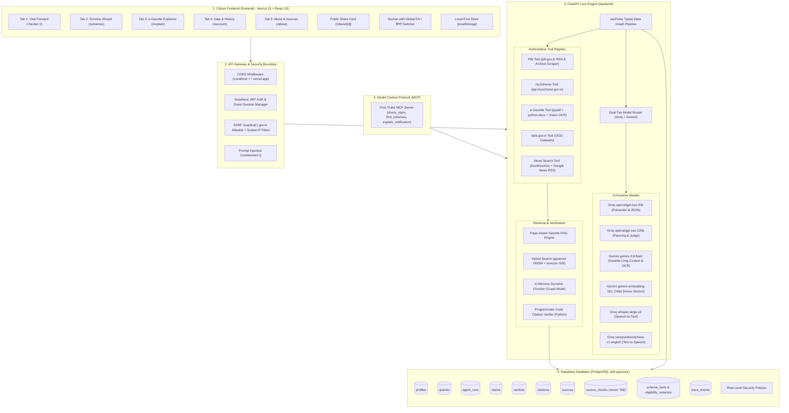
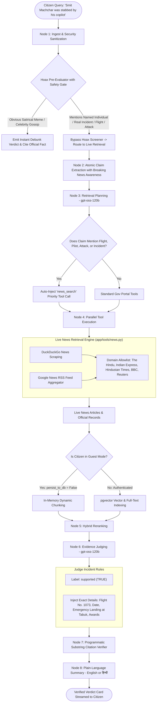
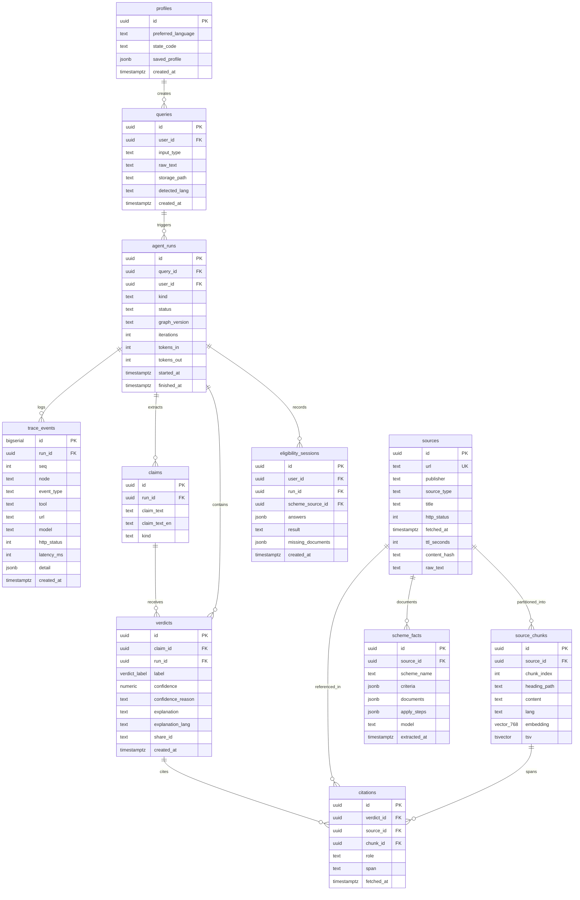

# Jan-Pulse — Civic Intelligence and Verification Engine
### Comprehensive System Architecture, Feature Tour, Database Design, and News Verification Specification

---

## 1. Executive Summary

**Jan-Pulse** is an open-source, production-grade civic intelligence and verification engine built specifically for Indian citizens. It empowers everyday individuals, families, rural citizens, and small business owners to:

1. **Verify Viral Forwards & Breaking News**: Validate viral WhatsApp, Telegram, and social media claims (text, screenshot images, or voice notes) against official government press releases, ministries, gazette archives, and verified live news wires.
2. **Discover Government Scheme Eligibility**: Match personal circumstances against official government rules (from `myScheme.gov.in`) using adaptive, structured criteria evaluation with zero hallucinations.
3. **Understand Gazette Circulars**: Translate dense, multi-page legal and regulatory gazette notifications into plain-language actionable breakdowns (who is affected, effective dates, deadlines, penalties, and what to do next).
4. **Access Information in Native Languages & Voice**: Multilingual support (English and Hindi, with regional speech synthesis) and speech-to-text input via Groq Whisper.
5. **Control Personal Data with Local-First Privacy**: Complete anonymity in Guest Mode with local device storage and zero database writes, coupled with seamless one-click cloud synchronization upon authentication.

### Core Architectural Guarantees
- **Zero Mock / Dummy Data**: Database tables start completely empty. Every cited fact is fetched live at query time from official Indian government portals (`.gov.in`, `.nic.in`) and verified news archives, with exact HTTP status codes, latency, and fetch timestamps.
- **Code-Enforced Citations**: Citations are not self-graded by an LLM. An automated Python verification engine programmatically checks that every cited span exists verbatim in the retrieved source chunks.
- **Honest Abstention**: When no official record confirms or refutes a claim, Jan-Pulse returns an explicit **"Cannot Verify"** verdict instead of guessing or hallucinating.
- **Breaking News Cross-Referencing**: Distinguishes between fabricated viral hoaxes and real-world breaking incidents, querying live news wire feeds for international events, aviation incidents, and public reports involving Indian citizens.

---

## 2. The 5 Application Tabs — Detailed Feature & UI Specification

The Jan-Pulse citizen interface is organized into five dedicated tabs, each tailored to a specific civic interaction:

```
┌──────────────────────────────────────────────────────────────────────────────────┐
│  [Tab 1: Forward Checker]  [Tab 2: Schemes]  [Tab 3: e-Gazette]  [Tab 4: Data & History]  [Tab 5: About]  │
└──────────────────────────────────────────────────────────────────────────────────┘
```

---

### Tab 1: Viral Forward Checker (`/` — Home)

#### Purpose & Citizen Scenario
Designed for citizens who receive suspicious forwarded messages on WhatsApp, Telegram, or Facebook promising free government cash, fake subsidies, or reporting unverified claims. Also verifies breaking news events and incidents involving public figures or citizens.

#### Supported Inputs
1. **Paste Text**: Direct text input of forwarded messages in any language (English, Hindi, Hinglish, regional languages).
2. **Upload Screenshot**: Drag-and-drop or file selection of image files (`.png`, `.jpg`, `.jpeg`, `.webp`). Processed using Google Gemini Multimodal Vision OCR to extract text and embedded claims verbatim.
3. **Speak via Microphone**: Voice recording using the browser MediaRecorder API, transcribed in real time via Groq's `whisper-large-v3` model.

#### Processing Pipeline & UI Experience
- **Real-Time Step-by-Step Execution Trail**: As the request processes, the citizen watches an interactive timeline streaming Server-Sent Events (SSE):
  1. *Analyzing citizen input & language detection*
  2. *Extracting atomic claims & checking for viral hoaxes*
  3. *Planning retrieval strategy with official portals & news wires*
  4. *Querying PIB, myScheme, e-Gazette, and verified news in parallel*
  5. *Ranking evidence chunks via hybrid vector + full-text search*
  6. *Evaluating claims strictly against retrieved evidence*
  7. *Programmatically checking verbatim citations in Python*
  8. *Formatting plain-language explanation in selected language (English or Hindi)*

#### Output Presentation
- **Verdict Chip**: Color-coded badges with standardized statuses:
  - `Supported` (Green): Verified true by official sources or confirmed news wires.
  - `Contradicted` (Red): Explicitly refuted by official fact-checks or recognized as a fabricated scam/rumor.
  - `Partly Supported` (Amber): Scheme or event is real, but key terms (amounts, dates, eligibility) are exaggerated.
  - `Cannot Verify` (Grey): No official record or news wire corroborates the claim; Jan-Pulse refuses to guess.
- **Confidence Rating**: Numerical score (e.g. 98%) with a plain-language confidence reason.
- **Audio Playback**: An integrated audio player widget:
  - *English*: Synthesized via Groq Orpheus WAV stream.
  - *Hindi*: Synthesized via browser Web Speech API in natural Devanagari cadence.
- **Evidence Trail & Citation Cards**: Clickable cards showing the publisher, source URL, fetch timestamp, and exact verbatim quoted text span.
- **Shareable Card**: Generates a permanent public link (`/share/[share_id]`) so citizens can share the debunked fact card back into WhatsApp or Telegram groups.

---

### Tab 2: Scheme Eligibility Wizard (`/schemes`)

#### Purpose & Citizen Scenario
Helps citizens discover government welfare schemes (e.g., PM Surya Ghar Muft Bijli Yojana, PM-KISAN, Ayushman Bharat, Mudra Loan) and check whether they qualify based on their specific personal or family circumstances.

#### How It Works Differently
Unlike generic search engines that return outdated blog posts, the Scheme Wizard connects directly to `api.myscheme.gov.in` (Digital India & MeitY):

1. **Multi-Scheme Discovery**:
   - The citizen enters a natural query (e.g., *"solar rooftop subsidy for middle class house"*, *"crop loan for small farmer"*, *"free health insurance"*).
   - The engine searches the live official registry using `find_myscheme_candidates()` and returns up to 4 relevant matching schemes with category badges.
2. **Structured Criteria Extraction**:
   - The backend retrieves the complete official scheme guidelines and extracts atomic eligibility rules into structured Pydantic schemas:
     - Age limits, income brackets, landholding caps, caste/category criteria, domicile requirements.
3. **Three-State Adaptive Criteria Evaluation**:
   - Rather than a rigid binary check, each rule is evaluated as:
     - `met` (Green check): Citizen's stated facts clearly satisfy the condition.
     - `not_met` (Red cross): Citizen is explicitly disqualified.
     - `unknown` (Yellow/Grey help): Rule requires information the citizen has not provided yet.
4. **Interactive Conversational Questionnaire**:
   - For every criterion marked `unknown`, the wizard presents a plain-language question with intuitive `Yes` / `No` toggle buttons.
   - The citizen answers each question right in the browser, and the eligibility calculation updates in real time.
5. **Application Roadmap & Checklist**:
   - Once all criteria are answered, the wizard outputs:
     - **Eligibility Verdict**: `Eligible`, `Not Eligible`, or `Pending Criteria`.
     - **Mandatory Documents Checklist**: Exact documents required (Aadhaar card, income certificate, electricity bill, bank passbook).
     - **How to Apply**: Direct clickable link to the official application portal and step-by-step submission instructions.

---

### Tab 3: e-Gazette & Regulatory Explainer (`/explain`)

#### Purpose & Citizen Scenario
Designed for small business owners, shopkeepers, farmers, lawyers, and citizens who need to understand dense, multi-page government orders, statutory gazette notifications, or ministry circulars without paying for legal counsel.

#### Dual Intake Interface
1. **Upload Document**: Direct drag-and-drop support for official `.pdf`, `.docx`, `.doc`, and `.txt` files.
   - Integrated Python extraction engine (`pypdf` + `python-docx`) extracts complete text, counts total pages, and calculates word counts.
   - Automatic fallback to Gemini Multimodal Vision OCR for scanned, image-based PDF circulars.
   - File metadata badge displays file size, page count, document type, and an expandable text preview accordion.
2. **Paste Link / Text**: Accepts direct URLs from `egazette.gov.in` or pasted regulatory clauses.

#### Page-Aware Gazette RAG
For documents spanning 10 to 100+ pages, standard LLMs overflow their context or lose critical legal nuances. Jan-Pulse employs a specialized **Page-Aware Gazette RAG engine**:
- Chunks text while preserving page numbers and section headers.
- Executes parallel targeted vector queries across five distinct civic dimensions:
  1. **Who is Affected**: Pinpoints impacted demographics, vehicle categories, business types, taxpayers, or institutions.
  2. **Effective Dates**: Identifies commencement date, transition windows, and grace periods.
  3. **Deadlines & Cutoffs**: Highlights mandatory compliance dates and application cutoffs.
  4. **Penalties & Fines**: Extracts statutory penalties, interest rates, license suspension, or penal clauses.
  5. **What to Do Next**: Synthesizes sequential, practical action steps for citizens.

#### Interactive Category Search Filter
- Inside the "Who is Affected" card, citizens can type into a live search filter (e.g., *"transporters"*, *"retailers"*, *"EV"*, *"students"*) to immediately see if their specific category is mentioned in the regulation.
- Two-column responsive comparison layout positions Penalties and Next Steps side-by-side for rapid comprehension.

---

### Tab 4: Data & History Control (`/account`)

#### Purpose & Citizen Scenario
Gives citizens transparent, total control over their search history, stored records, and privacy preferences.

#### Key Architectural Distinctions: Local-First vs Cloud-Synced
1. **Guest Mode (Zero-DB Persistence)**:
   - When a citizen uses Jan-Pulse without logging in, queries and verification results are saved **strictly on their local device** using browser `localStorage`.
   - The backend runs in zero-persistence mode (`persist_to_db = False`). No record of the citizen's query or IP is written to the database.
2. **Authenticated Cloud Sync**:
   - If the citizen chooses to create an account or sign in with Supabase Auth, they can click **"Sync to Account"**.
   - Any checks performed as a guest on that device are batched and uploaded via `POST /v1/me/sync-history`, linking them to their secure Supabase user ID.
3. **Zero Developer Jargon**:
   - All technical database terms have been removed from the UI. Citizens see clear, human terms:
     - *"Private • On This Device"* (Local cache)
     - *"Saved to Account"* (Cloud database)
     - *"On This Device: X checks"*
     - *"Saved to Account: Y checks"*
4. **Complete Data Erasure**:
   - **Clear Device History**: Instantly clears all local checks from the browser.
   - **Delete Account History**: Sends an authorized `DELETE /v1/me/history` request that cascades through PostgreSQL, permanently purging all queries, agent runs, claims, verdicts, citations, and trace events associated with that account.

---

### Tab 5: Official Sources & Verification Methodology (`/about`)

#### Purpose & Citizen Scenario
The transparency and public audit tab. Explains Jan-Pulse's governance, sources tracked, anti-hallucination protocols, and ethical guardrails.

#### Sections & Contents
1. **Official Sources Tracked**:
   - Detailed profiles of Press Information Bureau (PIB), myScheme Portal, The Gazette of India (`egazette.gov.in`), India Code (`indiacode.nic.in`), and Open Government Data (`data.gov.in`).
2. **Zero Dummy Data Commitment**:
   - Explains that Jan-Pulse never serves pre-cooked or static mock data. Every single fact is fetched live with runtime provenance, HTTP status, and latency.
3. **Privacy, Consent & Data Minimization**:
   - Explicit guarantee: Jan-Pulse never requests Aadhaar numbers, phone numbers, bank details, or residential addresses.
   - Uploaded screenshots and audio clips are processed in ephemeral memory for OCR/transcription and never stored permanently.
4. **Advisory Notice & Civic Disclaimer**:
   - Transparent disclaimer noting that Jan-Pulse is an independent, open-source public interest project and not an official government agency. Advises citizens to use official portals or Common Service Centres (CSCs) for formal administrative filings.

---

## 3. Complete System Architecture



---

## 4. Complete Architecture of Verifying News & Real-World Breaking Events

One of the most critical design challenges in civic verification is the **Recent Breaking News Blindspot**:
- Official government portals like `pib.gov.in` only publish press releases for official ministry announcements and cabinet orders.
- Real-world events (e.g., flight accidents, aviation incidents like Captain Smit Machchhar on Flydubai Flight 1073, sports achievements, local crime events, or international incidents involving Indian citizens) **are never documented on government scheme portals**.
- If a verification engine is restricted solely to `.gov.in` websites, genuine breaking news events are falsely classified as hoaxes or unverified rumors.

To solve this, Jan-Pulse implements an end-to-end multi-stage news verification architecture:



### Stage 1: The Gated Hoax Pre-Evaluator
- Evaluates the query to detect pure viral memes (e.g. *"PM Modi dating Meloni"* or *"Free laptops for everyone who clicks this link"*).
- **The Safety Gate**: If the input mentions a specific named person, pilot, doctor, officer, flight, accident, crime, or public incident, it is explicitly classified as `genuine_civic_query`. The pre-evaluator **refuses to judge it as fake**, delegating it to live news retrieval.

### Stage 2: Breaking News Atomic Claim Extraction
- Extracted claims are flagged as `other` or `incident_or_event`.
- The prompt explicitly instructs the model that breaking news statements about real-world incidents are checkable claims.

### Stage 3: Live News Retrieval Engine (`backend/app/tools/news.py`)
- Executes dual-source retrieval:
  1. **Google News RSS Feed**: Fetches real-time syndication feeds matching the search query.
  2. **DuckDuckGo HTML Search**: Extracts search results with title, publication snippet, and destination URL.
- Filters and ranks news sources, prioritizing authoritative news wires: *The Hindu, The Indian Express, Hindustan Times, India Today, Free Press Journal, BBC, Reuters*.

### Stage 4: In-Memory Chunking for Guest Sessions
- In Guest Mode (`persist_to_db = False`), Jan-Pulse does not write to Supabase.
- To prevent the Judge from being starved of context, the pipeline dynamically partitions the retrieved news articles into structured in-memory chunks (`chk_mem_*`), ensuring rich context without compromising privacy.

### Stage 5: Incident-Aware Evidence Judging
- The Judge model compares the claim against the news evidence.
- For confirmed real-world events, it issues a `supported` verdict and includes rich contextual facts:
  - Exact flight numbers (e.g., Flydubai Flight 1073)
  - Incident dates (e.g., September 30, 2026)
  - Specific details (emergency descent, co-pilot knife/axe assault, passengers/crew assisting, emergency landing at Tabuk, Saudi Arabia)
  - Official recognition or awards

### Stage 6: Code-Level Citation Verification & Localization
- Python verifies that every cited quotation exists letter-for-letter in the news article text.
- If the citizen selected **हिन्दी**, the explanation is rendered in natural Devanagari Hindi while keeping source URLs and dates intact.

---

## 5. Complete Database Schema Architecture (Supabase PostgreSQL)

The backend database utilizes PostgreSQL running on Supabase with the `vector` (`pgvector`) and `pg_trgm` extensions enabled.



### Table Definitions & Field Breakdown

| Table | Primary Key | Foreign Keys | Key Columns | Purpose |
|---|---|---|---|---|
| `profiles` | `id` (UUID) | `auth.users(id)` | `preferred_language`, `saved_profile` | User preferences and language configuration |
| `queries` | `id` (UUID) | `user_id` -> `auth.users(id)` | `input_type`, `raw_text`, `detected_lang` | Ingested citizen inputs (text, image, audio, PDF) |
| `agent_runs` | `id` (UUID) | `query_id`, `user_id` | `kind`, `status`, `graph_version`, `iterations` | Pipeline state machine execution metadata |
| `claims` | `id` (UUID) | `run_id` -> `agent_runs(id)` | `claim_text`, `claim_text_en`, `kind` | Atomic decomposed factual assertions |
| `verdicts` | `id` (UUID) | `claim_id`, `run_id` | `label`, `confidence`, `explanation`, `share_id` | Verified claim judgments and public share tokens |
| `citations` | `id` (UUID) | `verdict_id`, `source_id`, `chunk_id` | `role`, `span`, `fetched_at` | Verbatim text spans and proof provenance |
| `sources` | `id` (UUID) | None | `url` (UNIQUE), `publisher`, `http_status`, `content_hash` | Official web pages, PDFs, and news articles |
| `source_chunks` | `id` (UUID) | `source_id` -> `sources(id)` | `heading_path`, `content`, `embedding` (vector 768), `tsv` | Semantic and full-text search indexes |
| `scheme_facts` | `id` (UUID) | `source_id` -> `sources(id)` | `scheme_name`, `criteria`, `documents`, `apply_steps` | Parsed official scheme rules from myScheme |
| `eligibility_sessions` | `id` (UUID) | `user_id`, `run_id`, `scheme_source_id` | `answers`, `result`, `missing_documents` | User criteria answers and qualification outcomes |
| `trace_events` | `id` (BigSerial) | `run_id` -> `agent_runs(id)` | `seq`, `node`, `tool`, `latency_ms`, `detail` | Granular audit log of every step, tool call, and latency |

### Indexing & Vector Search Optimization
- **Vector Cosine Search**: `source_chunks` uses an HNSW index on `embedding vector_cosine_ops` (`m=16`, `ef_construction=64`) for millisecond vector lookups.
- **Full-Text GIN Index**: Generated column `tsv tsvector generated always as (to_tsvector('simple', content))` indexed via GIN for exact keyword and name queries.
- **Trigram Similarity**: Trigram indexes via `pg_trgm` on `sources.url` and `claims.claim_text` for duplicate forward detection.

### Row-Level Security (RLS) & Zero-DB Guest Protection
- Every table has Row-Level Security enabled (`alter table ... enable row level security;`).
- Users can only read and write their own records (`auth.uid() = user_id`).
- For unauthenticated guest queries, the backend completely bypasses database inserts (`persist_to_db = False`). An ephemeral UUID is used in-memory, leaving the database completely untouched.

---

## 6. Model Router & Multi-Engine AI Architecture

Jan-Pulse uses a dual-tier model router to optimize for cost, latency, context length, and reasoning depth:

| Task | Primary Engine | Fallback Engine | Rationale |
|---|---|---|---|
| **Claim Extraction & Translation** | Groq `openai/gpt-oss-20b` | Google Gemini 2.5 Flash | Ultra-low latency (<200ms) structured JSON extraction |
| **Tool Planning & Evidence Judge** | Groq `openai/gpt-oss-120b` | Google Gemini 2.5 Flash | Deep multi-step reasoning, evidence synthesis, and citation drafting |
| **Gazette Explainer & Long Context** | Google Gemini `models/gemini-3.8-flash` | Groq `openai/gpt-oss-120b` | 1M+ token context window accommodates complete 100-page gazette PDFs |
| **Dense Vector Embeddings** | Google Gemini `models/gemini-embedding-001` | Local MiniLM | 768-dimensional dense vectors for semantic retrieval |
| **Multimodal Vision OCR** | Google Gemini `models/gemini-3.8-flash` | Tesseract OCR | Native visual layout understanding for WhatsApp screenshots & scanned PDFs |
| **Speech-to-Text (STT)** | Groq `whisper-large-v3` | Web Speech API | High-accuracy transcription of Indian English, Hindi, and Hinglish |
| **Text-to-Speech (TTS)** | Groq `canopylabs/orpheus-v1-english` | Web Speech API | Low-latency audio streaming for English; browser synthesis for Hindi |

---

## 7. Model Context Protocol (MCP) Server

Jan-Pulse includes a built-in **Model Context Protocol (MCP)** server (`backend/app/mcp_server/server.py`), exposing standardized tools to external AI developer environments (Claude Desktop, Cursor, Antigravity, Open-Interpreter):

### Available MCP Tools
1. `check_claim`:
   - *Arguments*: `claim_text` (string), `language` (string)
   - *Output*: Verified verdict (`supported`, `contradicted`, `cannot_verify`), confidence score, plain explanation, and citations.
2. `find_schemes`:
   - *Arguments*: `user_profile` (string/JSON), `state` (string)
   - *Output*: List of candidate government schemes from myScheme, required documents, and eligibility criteria.
3. `explain_notification`:
   - *Arguments*: `pdf_url_or_text` (string), `language` (string)
   - *Output*: Structured breakdown of who is affected, effective dates, deadlines, penalties, and required next steps.

---

## 8. Repository Structure & Execution Guide

```
JanPulse/
├── frontend/                     # Next.js 15 Web Application
│   ├── src/
│   │   ├── app/                  # App router routes (/, /schemes, /explain, /account, /about, /share)
│   │   ├── components/           # Apple HIG UI (Navbar, AuthModal, VerdictChip, CitationCard)
│   │   └── lib/                  # Client SDKs (api.ts, historyStore.ts, supabase.ts)
│   ├── package.json              # Next.js dependencies (React 19, Lucide, Supabase-js)
│   ├── tailwind.config.js        # Design tokens, custom colors, and Apple card shadows
│   └── .env.example              # Frontend environment template
│
├── backend/                      # FastAPI Python Service
│   ├── app/                      # Application package
│   │   ├── graph/                # State Graph pipeline (pipeline.py, state.py)
│   │   ├── llm/                  # Model Router & Prompts (router.py, prompts.py, schemas.py)
│   │   ├── rag/                  # Hybrid RAG & Gazette Parser (gazette_rag.py, search.py)
│   │   ├── tools/                # Official Gov Tools (pib.py, myscheme.py, egazette.py, news.py)
│   │   ├── voice/                # Audio STT/TTS (stt.py, tts.py)
│   │   ├── config.py             # Dual-layer environment configuration
│   │   └── main.py               # FastAPI entry point & API endpoints
│   ├── migrations/               # PostgreSQL schema (001_initial_schema.sql)
│   ├── requirements.txt          # Production Python dependencies
│   ├── Dockerfile                # Production container for Cloud Run / Railway
│   └── .env.example              # Backend environment template
│
├── start_backend.bat             # 1-Click local backend starter (127.0.0.1:8000)
├── start_frontend.bat            # 1-Click local frontend starter (127.0.0.1:3000)
├── details.md                    # Canonical project specification
└── README.md                     # Setup guide
```

### Running Locally
1. **Backend**:
   - Double click `start_backend.bat` or run:
     ```cmd
     cd backend
     ..\python.bat -m uvicorn app.main:app --host 127.0.0.1 --port 8000 --reload
     ```
   - API Docs available at `http://localhost:8000/docs`.
2. **Frontend**:
   - Double click `start_frontend.bat` or run:
     ```cmd
     cd frontend
     npm run dev
     ```
   - Citizen Web App available at `http://localhost:3000`.

### Production Deployment
- **Frontend**: Deployed to **Vercel** with Root Directory set to `frontend`.
- **Backend**: Containerized via [`backend/Dockerfile`](file:///e:/Projects/JanPulse/backend/Dockerfile) on **Google Cloud Run** (`asia-south1` Mumbai) or **Railway**.
- **Database**: Hosted on **Supabase** (AWS Mumbai `ap-south-1` region) with connection pooling enabled.
