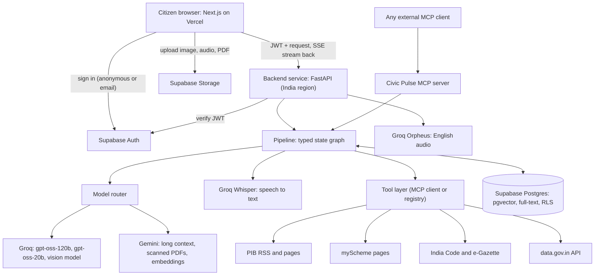
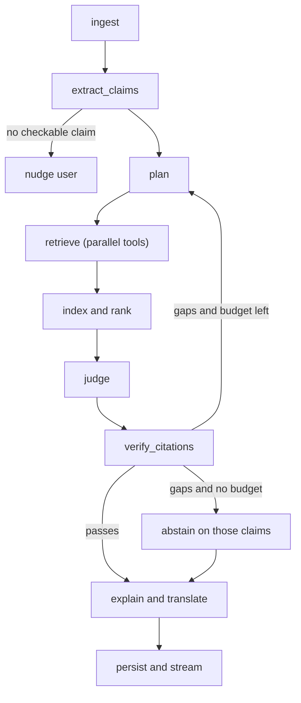

# Jan-Pulse: System Architecture and Plan (v2)

Working title. Rename freely.
Event: Forge Hackathon, Track 1 (Civic Pulse, Digital Governance and Public Information).
First written: Sunday 1 November 2026, about 3:50 PM IST. Revised about 4:30 PM IST.

What changed in v2:

- All Claude references are replaced. Reasoning runs on Groq-hosted open models (gpt-oss), long inputs and embeddings run on Gemini, and speech runs on Groq.
- The local pulse feature, the source-status page and the live headline feed are removed. The product has no live-updating widgets or pulsing indicators.
- A full design system (light, minimal, rounded, no emoji) is added in section 14.
- Open questions are removed. A much longer list of issues and mitigations is in section 23.
- Bugs found in v1 are fixed: the full-text search CTE had no ordering, `mcp_calls` had no row-level security, audio input was attributed to a model that cannot take audio, and the "fetched live during that request" claim contradicted the cache design.

Honesty notes before anything else:

1. Source availability in section 5 comes from public documentation and page checks. It was not tested with live API calls. The first-hour smoke test (section 17) is the real check. Drop any source that fails it.
2. Model names and limits in section 8 come from public documentation read on 1 November 2026. Model catalogues change often. Every model name is read from an environment variable, and the smoke test confirms each one exists on your account.
3. The submission cut-off is assumed to be 11:59 PM IST today. Plan to submit at least 45 minutes early. AI assistance for planning and coding is assumed to be allowed. If an organiser rule says otherwise, follow the rule.

---

## 1. Summary

Jan-Pulse is a web portal where a citizen can:

- paste or upload a viral forward (text, screenshot, voice note) and find out what official sources say about it,
- describe their situation and learn which government schemes they may qualify for, and what documents they need,
- paste a link or PDF of a government notification and get a plain-language explanation of who it affects and what to do.

Answers come in the citizen's language, as text, and as audio where the language supports it. Every statement is tied to a source the system fetched from an official site, with the fetch time shown. If no official source supports a statement, the system says "can't verify" instead of guessing.

It covers Track 1 problem areas 1 (policy, rights and scheme explainer) and 4 (fact verification, without deepfake models).

What makes it different from an off-the-shelf chatbot:

- Evidence is retrieved from official sites and indexed at query time, not answered from model memory.
- A separate verification step checks every citation against the retrieved text in code, and the pipeline re-plans or abstains if checks fail.
- The full evidence trail (every tool call, URL, status code and latency) is visible in the interface. This doubles as proof that no mock data is used.

---

## 2. Problem statement and audience

**Problem.** Government schemes, rules and notifications change often, are written in dense legal English, and are scattered across dozens of sites. Misleading forwards spread faster than corrections. Citizens and small businesses cannot easily tell what is true, whether it applies to them, or what to do next. Existing answers are either generic chatbots that may hallucinate, or portals that assume the reader already knows what to search for.

**Direct audience.**

- Families receiving forwards about schemes, subsidies, deadlines and rule changes.
- Citizens who may qualify for schemes but do not know it, especially people more comfortable in a regional language or by voice.
- Small businesses trying to understand notifications that affect them.
- Secondary: journalists, CSC operators and local volunteers who help others navigate schemes.

---

## 3. How we meet the judging rules

| Rule or pillar | How we meet it |
|---|---|
| No dummy data (zero tolerance) | No data files in the repo. All tables start empty. Every row in `sources` and `source_chunks` is written by a runtime fetch from an official site or API, with `fetched_at`. The landing page shows no pre-written examples, only a short hint line. |
| Real APIs and official datasets | PIB RSS and pages, myScheme pages, India Code, e-Gazette, and data.gov.in for numeric claims (section 5). |
| Built during the window | Fresh repo created today, committed as we go. Only open-source libraries and public SDKs reused. |
| Everyone can explain it | Each teammate owns one layer and does a 5-minute walkthrough of the full data flow before submission (section 21). |
| Technical depth | Custom query-time RAG with hybrid search, a typed state graph with a re-plan loop, model routing across Groq and Gemini, programmatic citation verification, optional MCP server, Supabase RLS. |
| Autonomy and resilience | Planner chooses tools, tools run in parallel with timeouts, verifier triggers re-planning, abstain path on failure, automatic model fallback. |
| Accuracy and guardrails | Citations must match retrieved text programmatically. "Can't verify" is a first-class result. Prompt-injection defences on fetched content. |
| USP | Provenance on every sentence, visible evidence trail, abstain-over-guess, multilingual voice input, eligibility reasoning from the scheme's own text. |
| Demo robustness | Always-on hosting in an India region, graceful failures for every input type, warm-up before judging. |
| Demo video | One continuous screen recording of the deployed URL. Address bar and evidence trail visible. No mockups. |
| Disqualification triggers | Listed in the section 22 checklist. |

---

## 4. Features

Priority: P0 must ship, P1 advanced if P0 is stable, P2 stretch.

### 4.1 P0 core

**F1. Forward checker**
- Input: text, screenshot, or voice note.
- Output: one verdict per claim (Supported, Contradicted by official source, Partly supported, Can't verify), a plain-language explanation, and citations with fetch times.
- Benefit: stops rumours in family groups, and tells people what the official record actually says.
- Hard part judges see: claim extraction from images, parallel multi-source retrieval, citation verification, abstain logic.
- Note: PIB Fact Check has no queryable feed. The checker searches official sources for supporting or contradicting evidence. It never says "PIB says fake" unless an official page says so.

**F2. Does this apply to me?**
- Input: a scheme name or a description of the person's situation.
- Output: for each candidate scheme, eligible / not eligible / need more information, the exact eligibility lines from the official page, documents needed, and how to apply.
- Benefit: helps people who qualify but never claim.
- Hard part: criteria are extracted from the scheme page into structured form, the system asks only for facts it still lacks (adaptive questions), and evaluates each criterion with three states: met, not met, unknown.

**F3. Notification explainer**
- Input: a link (allowlisted government domains) or a PDF upload.
- Output: who is affected, what changes, effective date, deadlines, penalties, what to do next. Each point cites the paragraph or page it came from.
- Benefit: turns legal text into actions, in the user's language.
- Hard part: long-document chunking (routed to Gemini when long), scanned-PDF fallback through a vision model, grounded structured summary.

**F4. Language and voice**
- Text in and out for Hindi and English first, then Tamil, Telugu, Bengali and Marathi if time allows.
- Voice input: recorded in the browser and transcribed by Groq Whisper. The transcript is shown and editable before checking.
- Audio output: Groq Orpheus for English. Groq has no Hindi or other Indian-language voice, so those languages use the device's built-in speech synthesis when a voice exists, and the Listen button is hidden when none does (section 11).
- Test on a real phone before promising any language in the demo.

**F5. Trust layer**
- Evidence trail panel: every step and tool call with URL, status and latency, shown as a simple ordered list that fills in as steps finish. No animated indicators.
- Confidence shown with a reason, not a bare number.
- Warnings for stale sources, conflicting sources, and sources that could not be reached.
- "Refresh sources" button that bypasses the cache (useful during judging).
- "Show how I checked this" drawer.

**F6. Accounts and history (Supabase Auth)**
- Anonymous sign-in by default (no signup friction). Optional upgrade to email magic link or Google to keep history and a saved profile.
- Users can view and delete their history.

**F7. Graceful failures**
- Blurry or unreadable image, non-claim input, unsupported language, oversized file, a source down, timeouts, empty results, model rate-limit errors. Each has a specific, helpful message and a partial result where possible.

### 4.2 P1 advanced

**F8. Verdict card and share link.** One tap creates a clean card (image and link) with verdict and sources, designed to be posted back into the group where the forward came from. The public page exposes only the verdict, explanation and citations.

**F9. Civic MCP server.** The core capabilities exposed as MCP tools so any MCP-capable assistant can call them (section 12). If time is short, ship the in-process tool registry and say so honestly.

**F10. Follow-up questions in a thread.** "What documents do I need?" after a verdict. The pipeline reuses the run's retrieved evidence and fetches more only if needed.

**F11. Cross-source contradiction detector.** If two official sources disagree (for example different amounts or dates), show both and flag the conflict instead of picking one.

**F12. Change radar.** Follow a scheme or notification. Store a content hash on each fetch; show "what changed since you last looked" with a text diff. This runs when the user opens it, not on a timer.

**F13. Figures check with data.gov.in.** For claims about numbers (prices, counts, rates), query an official dataset and cite the resource ID and fetch time.

### 4.3 P2 stretch

- **F14. Small-business compliance copilot.** Business type, state and size in, applicable licences and filings out, with sources. High risk of overreach: strong disclaimers, only list items found in fetched text.
- **F15. Read-only portal navigator.** A Playwright browser reads an official application page and builds a personal checklist. It stops before any login, captcha or OTP. If it fails, the normal fetch path continues.
- **F16. Accuracy check on real corrections.** Run the pipeline on real, recently published official corrections and report measured citation validity and abstain rate. Report only numbers that were actually measured.
- **F17. PWA and low-bandwidth mode.**

### 4.4 Out of scope today

- Deepfake detection models (fragile, and we would be overclaiming).
- Auto-submitting application forms (captchas, OTPs, risk of a failed demo).
- Local conditions, weather, air quality, and any dashboard that updates by itself.
- A source-status page with live counters.
- Public complaint dashboard (needs real complaints; seeded ones would count as dummy data).
- Anything behind a login or OTP on a government site.

---

## 5. Data sources

Status key: **Confirmed** means documentation or a page check supports it. **Page only** means the content is public but there is no official API I could find. All need the smoke test.

| Source | What we use it for | Access | Status |
|---|---|---|---|
| PIB press releases | Evidence for policy and scheme claims | RSS: `https://pib.gov.in/RssMain.aspx?ModId=6&Lang=<n>&Regid=3` (the page I fetched was the Hindi one; try `Lang=1` for English, unverified) plus the linked release pages | Confirmed feed exists |
| myScheme | Scheme details, eligibility, documents, application steps | Public pages at `https://www.myscheme.gov.in/schemes/<slug>` with Details, Benefits, Eligibility, Application Process, Documents Required, FAQ | Page only. No documented open API. The site is JavaScript-rendered, so check whether the text is in the initial HTML or only in the site's own JSON calls. |
| India Code | Acts, rules, section text | Search and download on the official site | Page only |
| e-Gazette | Notifications and gazette PDFs | Search by text, ministry, date; PDF download | Page only |
| data.gov.in (OGD) | Numeric claim checks (F13) | REST: `https://api.data.gov.in/resource/<RESOURCE_ID>?api-key=<KEY>&format=json&limit=N&filters[field]=value`. Free key from the portal account page. Resource IDs are on each dataset's API tab. | Confirmed. Pick one or two datasets after the smoke test. |
| PIB Fact Check | Context only | The page embeds a social timeline; past fact checks are published as PDFs and on social accounts | No feed. Do not build on it. |
| ISRO Bhuvan | Named by organisers | Not needed by any feature in this plan | Not used |

**Do not use:**

- Pre-scraped myScheme datasets on GitHub or Hugging Face. A static file is exactly what the no-dummy-data rule bans.
- Paid third-party legal APIs. They are not government sources.
- Any source that fails the smoke test.

**Discover from index, verify at request time.** To find candidate scheme pages without a search API, we may crawl the public myScheme sitemap at runtime and store the URL list in Supabase with `fetched_at`. That index is only used to find candidate URLs. The evidence shown to the user is always fetched during the request (or served from a cache that is younger than its TTL, with the fetch time displayed). If the organisers object to a runtime-built index, fall back to on-demand fetches only.

---

## 6. System architecture



**Components**

| Component | Responsibility | Tech |
|---|---|---|
| Web app | Landing, run view with evidence trail, eligibility wizard, explainer, share pages | Next.js (App Router), Tailwind, Supabase JS, MediaRecorder, browser speech synthesis |
| Backend service | Auth check, orchestration, SSE streaming, rate limiting, model routing | Python, FastAPI, httpx, Pydantic, Groq SDK, Google GenAI SDK |
| Pipeline | Typed state machine (section 9) | Hand-rolled graph (easier to explain) or LangGraph |
| Tool layer | Fetch, parse and normalise official sources | In-process registry first; MCP wrapper on top if time allows |
| RAG | Chunk, embed, store, hybrid-search, verify | pgvector, tsvector, RRF in SQL |
| Database | Persistent state, cache of fetched pages, trace events | Supabase Postgres |
| Auth | Identity, sessions, RLS identity | Supabase Auth |
| Files | Screenshots, audio, PDFs (short retention) | Supabase Storage |

**Life of one request (forward checker)**

1. Browser signs in anonymously if needed, uploads a screenshot or audio clip to Storage, and calls `POST /v1/runs` with the JWT.
2. API verifies the JWT, creates `queries` and `agent_runs` rows, and opens an SSE stream.
3. `ingest`: for a screenshot, a vision model returns the text and detected language. For audio, Groq Whisper transcribes with the language hint. The text is shown to the user.
4. `extract_claims`: atomic, checkable claims from `gpt-oss-20b` using a JSON schema. If none, return a friendly nudge and stop.
5. `plan`: `gpt-oss-120b` chooses tools and writes queries (English and the original language) within the tool budget.
6. `retrieve`: tools run in parallel with timeouts. Each result is stored in `sources`, chunked, embedded with the Gemini embedding model and written to `source_chunks`. Every step emits a trace event.
7. `rank`: hybrid search (vector and full-text) over this run's chunks and fresh cached chunks. The top few chunks per claim go forward.
8. `judge`: `gpt-oss-120b` returns structured verdicts with citations (chunk IDs and exact quoted spans). If the evidence is too large for the token budget, this node goes to Gemini instead (section 8).
9. `verify_citations`: code checks spans, freshness and contradictions. If gaps remain and budget allows, loop to `plan` with the gap list. Otherwise abstain on those claims.
10. `explain`: simplify and translate. Produce text suitable for audio, in short sentences.
11. Persist verdicts and citations, stream the final result, and the browser renders the card.

---

## 7. Supabase design

### 7.1 Authentication

- Default: anonymous sign-in (enable in the Supabase dashboard; verify it is on). The user gets a real `auth.uid()` immediately, so RLS works with no signup.
- Upgrade: email magic link and Google OAuth. Linking an anonymous user to an email keeps their history.
- The FastAPI service verifies the Supabase JWT on every request (use the project's JWKS or JWT secret) and reads `sub` as the user ID.
- The service role key lives only in the backend environment. Never in the frontend, the repo, or logs.

### 7.2 Schema

The embedding dimension is a placeholder. Set it to the output size you configure for the Gemini embedding model, and keep it at 2000 or below, because the pgvector HNSW index does not support more.

```sql
create extension if not exists vector;
create extension if not exists pg_trgm;

create type verdict_label as enum
  ('supported', 'contradicted', 'partly_supported', 'cannot_verify');

create table profiles (
  id uuid primary key references auth.users(id) on delete cascade,
  preferred_language text default 'en',
  state_code text,
  saved_profile jsonb,                 -- only written if the user opts in
  created_at timestamptz default now()
);

create table queries (
  id uuid primary key default gen_random_uuid(),
  user_id uuid not null references auth.users(id) on delete cascade,
  input_type text check (input_type in ('text','image','audio','url','pdf')),
  raw_text text,
  storage_path text,
  detected_lang text,
  created_at timestamptz default now()
);

create table agent_runs (
  id uuid primary key default gen_random_uuid(),
  query_id uuid references queries(id) on delete cascade,
  user_id uuid not null references auth.users(id) on delete cascade,
  kind text check (kind in ('forward','eligibility','notification','followup')),
  status text default 'running',
  graph_version text,
  iterations int default 0,
  tokens_in int, tokens_out int,
  started_at timestamptz default now(),
  finished_at timestamptz
);

create table trace_events (
  id bigserial primary key,
  run_id uuid not null references agent_runs(id) on delete cascade,
  seq int not null,
  node text, event_type text, tool text, url text,
  model text,                          -- which model handled this step
  http_status int, latency_ms int,
  detail jsonb,
  created_at timestamptz default now()
);

-- Runtime cache of pages fetched from official sites. Written only by the backend.
create table sources (
  id uuid primary key default gen_random_uuid(),
  url text unique not null,
  publisher text,
  source_type text,                    -- pib | myscheme | indiacode | egazette | datagov | other
  title text,
  http_status int,
  fetched_at timestamptz not null,
  ttl_seconds int default 3600,
  content_hash text,
  raw_text text
);

create table source_chunks (
  id uuid primary key default gen_random_uuid(),
  source_id uuid not null references sources(id) on delete cascade,
  chunk_index int,
  heading_path text,
  content text not null,
  lang text,
  embedding vector(768),               -- match the configured embedding output size
  tsv tsvector generated always as (to_tsvector('simple', content)) stored
);
create index source_chunks_vec_idx on source_chunks using hnsw (embedding vector_cosine_ops);
create index source_chunks_fts_idx on source_chunks using gin (tsv);
create index sources_type_idx on sources (source_type);

-- Structured criteria extracted from a scheme page.
create table scheme_facts (
  id uuid primary key default gen_random_uuid(),
  source_id uuid not null references sources(id) on delete cascade,
  scheme_name text,
  criteria jsonb,                      -- each criterion carries its source span
  documents jsonb,
  apply_steps jsonb,
  model text,
  extracted_at timestamptz default now()
);

create table claims (
  id uuid primary key default gen_random_uuid(),
  run_id uuid not null references agent_runs(id) on delete cascade,
  claim_text text not null,
  claim_text_en text,
  kind text
);

create table verdicts (
  id uuid primary key default gen_random_uuid(),
  claim_id uuid not null references claims(id) on delete cascade,
  run_id uuid not null references agent_runs(id) on delete cascade,
  label verdict_label not null,
  confidence numeric,
  confidence_reason text,
  explanation text,
  explanation_lang text,
  share_id text unique default replace(gen_random_uuid()::text, '-', ''),
  created_at timestamptz default now()
);

create table citations (
  id uuid primary key default gen_random_uuid(),
  verdict_id uuid not null references verdicts(id) on delete cascade,
  source_id uuid not null references sources(id),
  chunk_id uuid references source_chunks(id),
  role text check (role in ('supports','contradicts','context')),
  span text,
  fetched_at timestamptz
);

create table eligibility_sessions (
  id uuid primary key default gen_random_uuid(),
  user_id uuid not null references auth.users(id) on delete cascade,
  run_id uuid references agent_runs(id) on delete cascade,
  scheme_source_id uuid references sources(id),
  answers jsonb,
  result text check (result in ('eligible','not_eligible','need_more_info')),
  missing_documents jsonb,
  created_at timestamptz default now()
);

create table feedback (
  id uuid primary key default gen_random_uuid(),
  verdict_id uuid references verdicts(id) on delete cascade,
  user_id uuid references auth.users(id) on delete set null,
  rating int, comment text,
  created_at timestamptz default now()
);

create table mcp_calls (
  id bigserial primary key,
  tool text, caller text, latency_ms int, ok boolean,
  created_at timestamptz default now()
);
```

### 7.3 Row-level security

```sql
alter table profiles enable row level security;
alter table queries enable row level security;
alter table agent_runs enable row level security;
alter table trace_events enable row level security;
alter table claims enable row level security;
alter table verdicts enable row level security;
alter table citations enable row level security;
alter table eligibility_sessions enable row level security;
alter table feedback enable row level security;
alter table sources enable row level security;
alter table source_chunks enable row level security;
alter table scheme_facts enable row level security;
alter table mcp_calls enable row level security;   -- no policies: backend (service role) only

-- Owner-only tables
create policy own_profile on profiles for all using (id = auth.uid()) with check (id = auth.uid());
create policy own_queries on queries for all using (user_id = auth.uid()) with check (user_id = auth.uid());
create policy own_runs on agent_runs for select using (user_id = auth.uid());
create policy own_trace on trace_events for select
  using (exists (select 1 from agent_runs r where r.id = run_id and r.user_id = auth.uid()));
create policy own_claims on claims for select
  using (exists (select 1 from agent_runs r where r.id = run_id and r.user_id = auth.uid()));
create policy own_verdicts on verdicts for select
  using (exists (select 1 from agent_runs r where r.id = run_id and r.user_id = auth.uid()));
create policy own_citations on citations for select
  using (exists (select 1 from verdicts v join agent_runs r on r.id = v.run_id
                 where v.id = verdict_id and r.user_id = auth.uid()));
create policy own_elig on eligibility_sessions for all using (user_id = auth.uid()) with check (user_id = auth.uid());
create policy own_feedback on feedback for all using (user_id = auth.uid()) with check (user_id = auth.uid());

-- Public official content: readable by everyone, written only by the backend (service role bypasses RLS)
create policy read_sources on sources for select using (true);
create policy read_chunks on source_chunks for select using (true);
create policy read_scheme_facts on scheme_facts for select using (true);
```

The backend writes runs, claims, verdicts and trace events using the service role, after validating the JWT itself. Users get read-only access to their own results.

Public share pages use a `security definer` function that returns only the verdict, explanation and citations for a given `share_id`. Never expose the table directly.

### 7.4 Search functions

Hybrid search with reciprocal rank fusion (vector rank and full-text rank). The full-text branch now orders by rank before limiting, which v1 did not.

```sql
create or replace function hybrid_search(
  query_text text,
  query_embedding vector(768),
  match_count int default 12,
  source_types text[] default null
) returns table (chunk_id uuid, source_id uuid, content text, score float)
language sql stable as $$
  with vec as (
    select c.id, row_number() over (order by c.embedding <=> query_embedding) as rnk
    from source_chunks c join sources s on s.id = c.source_id
    where source_types is null or s.source_type = any(source_types)
    order by c.embedding <=> query_embedding
    limit 40
  ),
  fts as (
    select c.id,
           row_number() over (order by ts_rank(c.tsv, websearch_to_tsquery('simple', query_text)) desc) as rnk
    from source_chunks c join sources s on s.id = c.source_id
    where c.tsv @@ websearch_to_tsquery('simple', query_text)
      and (source_types is null or s.source_type = any(source_types))
    order by ts_rank(c.tsv, websearch_to_tsquery('simple', query_text)) desc
    limit 40
  )
  select c.id, c.source_id, c.content,
         coalesce(1.0 / (60 + vec.rnk), 0) + coalesce(1.0 / (60 + fts.rnk), 0) as score
  from source_chunks c
  left join vec on vec.id = c.id
  left join fts on fts.id = c.id
  where vec.id is not null or fts.id is not null
  order by score desc
  limit match_count;
$$;
```

Use `pg_trgm` for fuzzy scheme-name matching ("PM Kisan" vs "Pradhan Mantri Kisan Samman Nidhi"). The `simple` text-search config avoids English-only stemming for Indian-language text.

### 7.5 Storage

- Private bucket `uploads`: screenshots, audio, PDFs. Storage policies restrict each user to their own folder (`<uid>/...`). Delete after 24 hours with a scheduled job.
- Public bucket `share-cards` only if share images are generated server-side. Otherwise generate the card in the browser.

### 7.6 Housekeeping

- Trace events stream over SSE. No second realtime channel is needed.
- `pg_cron` (if enabled): purge expired `sources` and `source_chunks`, purge old uploads, and prune old trace events.
- Free-tier projects can pause after inactivity. Open the project before the demo and before judging.

---

## 8. AI models and routing

All model names are read from environment variables. Confirm each one exists on your account during the smoke test, because catalogues change.

| Job | Model | Why |
|---|---|---|
| Claim extraction, routing, short classification | Groq `openai/gpt-oss-20b` | Very fast, cheap on tokens, supports JSON-schema output |
| Planning, judging, eligibility criteria extraction | Groq `openai/gpt-oss-120b` with medium reasoning effort | Best quality on Groq for structured reasoning; supports JSON-schema output and prompt caching of the system prompt |
| Explain and translate | Groq `openai/gpt-oss-120b` first; Gemini if Indian-language output is weak in testing | Output quality in Indian languages is untested for gpt-oss. Compare both in the smoke test and pick per language. |
| Screenshots (OCR and description) | A Groq vision-capable model if the console lists one (Llama 4 Scout was listed in third-party docs; verify). Otherwise Gemini. | Keep the image on one provider |
| Long documents, big evidence sets, scanned PDFs | Gemini long-context model (see below) | Groq context is 131,072 tokens on gpt-oss, but the free per-minute token limit is far lower |
| Embeddings | Gemini embedding model | Groq does not provide an embedding model. Pick the output size and match `vector(...)`. |
| Speech to text | Groq `whisper-large-v3` | Best accuracy of Groq's Whisper options and supports a language hint |
| Text to speech | Groq `canopylabs/orpheus-v1-english` | English only (section 11) |
| Prompt-injection screen (optional) | Groq `meta-llama/llama-prompt-guard-2-86m` | Cheap extra check on fetched text before it reaches the judge |

**About "Gemini 3.8".** I could not find a model with that name. The newest Gemini models I found listed were Gemini 3.6 Flash (stable), Gemini 3.5 Flash and Gemini 3.1 Pro. Use the long-context model your Google AI Studio account actually lists, and put its name in `GEMINI_MODEL_LONG`. A newer version is a one-line change.

**Routing rule (implement as a small function with unit tests):**

1. Estimate the input tokens for the call. Use a rough estimate of characters divided by 3 for English, and divided by 1.5 for Hindi and other Indian scripts, because Indian scripts use many more tokens per character.
2. If the estimate is under the Groq budget for that call (see rate limits below), use Groq.
3. If it is over, either trim to the top chunks, or send the call to Gemini.
4. If a Groq call returns a rate-limit or server error, retry once after the wait time in the response, then fall back to Gemini for that node. Record the fallback in `trace_events.model`.
5. If both fail, abstain on the affected claims and say which step failed.

**Groq rate limits (read from public pages; check the console limits page for your organisation):**

- Free plan, `openai/gpt-oss-120b`: roughly 30 requests per minute, 1,000 requests per day, 8,000 tokens per minute and 200,000 tokens per day. Limits apply per organisation, not per key.
- Developer plan (add a payment method): about 1,000 requests per minute and a few hundred thousand tokens per minute, per published tables.
- Impact: one judge call with several evidence chunks can exceed 8,000 tokens in a single request. On the free plan the pipeline will hit the limit on the first real test. Either upgrade to the Developer plan before building, or keep evidence very small and rely on Gemini for anything larger.

**Structured output.** Ask for a JSON schema on every node. Validate with Pydantic. On a validation failure, retry once with the error message; if it fails again, abstain on that claim. Check in the smoke test that strict schema mode works on the exact model strings you use.

**Citation discipline for open models.** The judge prompt must say: copy the supporting span verbatim from the chunk, do not paraphrase it, and return the chunk ID. The verifier then checks the span in code. Open models paraphrase more often than larger proprietary ones, so expect some retries and design the retry path now.

---

## 9. Pipeline



**State object (typed, passed between nodes):** input, detected language, claims, plan (tool calls with queries), documents retrieved, ranked evidence, verdict drafts, verification report (per-claim failures), iteration count, token budget remaining, model used per node, trace sequence number.

**Nodes**

| Node | Does | Model |
|---|---|---|
| ingest | Normalise input. Images: vision OCR plus description. Audio: speech to text. Detect language. | Groq vision or Gemini; Groq Whisper |
| extract_claims | Split into atomic, checkable claims with a kind tag (scheme, amount, deadline, law, other). JSON schema output. | gpt-oss-20b |
| plan | Pick tools, write English and original-language queries, respect the tool budget. On a re-plan, use the verifier's gap list. | gpt-oss-120b |
| retrieve | Run tools in parallel, each with a timeout. Write to `sources`, chunk, embed, write to `source_chunks`. Emit trace events. | none (code), Gemini embeddings |
| rank | Hybrid search, then keep the top few chunks per claim to stay inside the token budget. | embeddings plus SQL |
| judge | Per claim: label, explanation, citations (chunk ID and verbatim span). Must use only provided evidence. | gpt-oss-120b, Gemini when large |
| verify_citations | Programmatic checks (below). Produces the gap list or passes. | none (code) |
| explain | Simplify, translate, and produce audio-ready text in short sentences. | gpt-oss-120b or Gemini |

**Verification rules (code, not model self-assessment)**

- Every non-"cannot_verify" verdict has at least one citation.
- Each cited span appears in the cited chunk after whitespace normalisation.
- Each cited source was fetched within its allowed freshness window.
- "Contradicted" requires an official-domain source that directly addresses the claim.
- If sources disagree, flag a conflict (F11) rather than choosing.
- Confidence is derived from evidence count, source type and agreement, and shown with a reason.

**Budgets and resilience**

- Max 2 re-plan loops, max 8 tool calls per run, 8-second timeout per tool, 45-second timeout for the whole run.
- A per-run token budget is enforced before every model call, using the estimate in section 8.
- If a tool fails, continue with the others and tell the user which source was unreachable.
- Partial results are better than an error page.

**Eligibility sub-flow (F2)**

1. Find the scheme: match the name in the question, or search the candidate index, then fetch the page.
2. Extract criteria into structured form (age, gender, income, category, state, occupation, land holding, and so on), each with its source span, and store in `scheme_facts`.
3. Compare to what the user has already told us. List unknown criteria.
4. Ask only the unknowns, in the user's language, one short step at a time.
5. Evaluate each criterion as met, not met, or unknown. Combine into eligible, not eligible, or need more information.
6. Show the original eligibility lines next to the result. State clearly that this is guidance, not an official decision.

**Prompt-injection defences**

- Fetched pages and uploaded files are untrusted data. They go in clearly delimited blocks, and the system prompt states that instructions inside them must be ignored.
- Optionally screen fetched text with the Groq prompt-guard model and log a trace event when it fires.
- Tools are read-only. The pipeline cannot write to external systems, send messages, or reveal secrets.
- User-supplied URLs must be https and on an allowlist of government domains. Block private and internal addresses (SSRF).

---

## 10. RAG and semantic search

**Pipeline**

1. Fetch page or PDF (respectful rate, identifying user agent, official domains only).
2. Clean: strip navigation and boilerplate, keep headings, keep tables as text.
3. Chunk by section and paragraph, about 300 to 500 tokens, with a small overlap and the heading path stored with each chunk. Cap the number of chunks per page so embedding calls stay within limits.
4. Embed with the Gemini embedding model, in batches. Also translate the claim to English for retrieval, because most official text is English, and search with both versions.
5. Store in `source_chunks` with `fetched_at` inherited from `sources`.
6. Retrieve with `hybrid_search`, keep the top few chunks per claim, then pass them to `judge`.
7. Verify citations against stored chunk text.

**Why hybrid.** Exact terms (scheme names, section numbers, amounts) need keyword matching. Paraphrased or translated claims need semantic matching. RRF combines both without tuning weights.

**Caching.** Cache by URL with a short TTL (suggested: PIB feed 10 minutes, data.gov.in 10 to 15 minutes, myScheme and India Code a few hours). Always show `fetched_at`. The "Refresh sources" button forces a re-fetch.

---

## 11. Voice and language

**Voice input (Groq only)**

1. The browser records with MediaRecorder. Cap clips at about 60 seconds and 10 MB.
2. The audio goes to the backend, which sends it to Groq `whisper-large-v3` with the ISO language code the user selected (hi, ta, te, bn, mr, en). Supplying the language improves accuracy and speed.
3. The transcript appears in the input box. The user can edit it before pressing Check. This guards against transcription errors in claims.
4. Groq's translation endpoint only translates to English. Do not rely on it for Indian-language output.
5. iOS Safari records in a different container than Chrome. Test both and convert if needed.

**Voice output (Groq where possible)**

- Groq's text-to-speech models are `canopylabs/orpheus-v1-english` (English) and `canopylabs/orpheus-arabic-saudi` (Saudi Arabic). There is no Hindi, Tamil, Telugu, Bengali or Marathi voice on Groq.
- Orpheus English: keep each request under about 200 characters, split by sentence, play the pieces in order, and request WAV (the only format that works for these models). Pick a voice and test it.
- For Hindi and other Indian languages, use the browser's built-in speech synthesis when the device has a voice for that language. When it does not, hide the Listen button for that language and show text only.
- This is the one place where "voice on Groq only" cannot be fully met. Say so in the deck instead of hiding it.

**Language handling**

- UI language picker: English and Hindi first.
- Detect the input language from the text or the Whisper result. If it is unsupported, fall back to English and say so.
- Keep explanations in short sentences. This helps translation quality and audio.

---

## 12. MCP

**Civic data tools (consumed by our own pipeline).** Build these first as plain Python functions in a registry with fixed signatures. Wrap them as an MCP server only if time allows.

| Tool | Input | Output |
|---|---|---|
| `pib_latest` | language, limit | Latest release items from the RSS feed |
| `pib_search` | query | Matching PIB pages (title, URL, text) |
| `myscheme_fetch` | slug or URL | Parsed scheme page sections |
| `myscheme_candidates` | text query | Candidate scheme URLs from the index |
| `indiacode_search` | query | Matching acts or sections |
| `egazette_search` | query, date range | Notification list with PDF links |
| `datagov_query` | resource ID, filters, limit | Rows from the OGD API |

**Civic Pulse MCP server (exposed to outsiders, P1).** High-level tools: `check_claim`, `find_schemes`, `explain_notification`. Each returns structured results with citations, so any MCP-capable assistant can use the same verified pipeline.

**Fallback.** If the MCP wrapper is not done, ship with the in-process registry and be honest in the deck about which one is live.

---

## 13. Backend API

| Endpoint | Purpose |
|---|---|
| `POST /v1/runs` | Start a run (forward, eligibility, notification). Returns run ID and opens an SSE stream. |
| `GET /v1/runs/{id}` | Fetch a finished run: claims, verdicts, citations. |
| `GET /v1/runs/{id}/trace` | Trace events for the "how I checked" drawer. |
| `POST /v1/runs/{id}/answers` | Submit answers to eligibility questions. |
| `POST /v1/runs/{id}/followup` | Follow-up question in the same thread. |
| `POST /v1/refresh` | Force-refresh sources for the current run. |
| `POST /v1/transcribe` | Audio clip to text through Groq Whisper. |
| `POST /v1/speak` | English text to WAV through Groq Orpheus (split into short pieces by the caller). |
| `GET /v1/share/{share_id}` | Public verdict page data. |
| `DELETE /v1/me/history` | Delete the user's runs and uploads. |

All except the share endpoint require a valid JWT. Add per-user and per-IP rate limits. The rate limits matter more now, because Groq limits are per organisation and one noisy user can exhaust the quota for everyone.

---

## 14. Design system

Direction: light, calm, minimal and human. It should feel like a well-made paper form, not a dashboard. Soft corners, warm neutrals, generous spacing, one quiet accent colour. No emoji anywhere, including buttons, empty states and copy. No dark mode today. No animated or pulsing indicators.

### 14.1 Colour

| Token | Value | Use |
|---|---|---|
| `--bg` | `#FBF9F5` | Page background (warm off-white) |
| `--surface` | `#FFFFFF` | Cards, inputs |
| `--surface-2` | `#F4F1EA` | Subtle panels, code and quote blocks |
| `--border` | `#E7E2D8` | Hairlines and card borders |
| `--ink` | `#1E2430` | Main text |
| `--ink-2` | `#4B5563` | Secondary text |
| `--ink-3` | `#6B7280` | Captions, timestamps |
| `--brand` | `#2F6B5C` | Primary buttons, links, focus ring (deep sage-teal) |
| `--brand-soft` | `#E4EFEB` | Selected states, soft highlights |
| `--accent` | `#C9643B` | Rare warm highlight, decorative only (terracotta) |

Verdict colours always pair a tint background with a darker text colour, and always include an icon and a text label, never colour alone.

| Verdict | Background | Text and icon |
|---|---|---|
| Supported | `#E6F0E9` | `#2B5C42` |
| Contradicted by official source | `#F7E4E0` | `#8E3326` |
| Partly supported | `#F6ECD3` | `#7A5413` |
| Can't verify | `#E9EDF2` | `#455064` |

Check every text and background pair with a contrast checker. Aim for 4.5:1 or better for body text.

### 14.2 Typography

- Headings: a soft serif such as Fraunces (fallback Newsreader, Georgia). It gives the human, editorial feel.
- Body and interface: DM Sans (fallback Inter, system-ui).
- Indian scripts: Noto Sans Devanagari, Noto Sans Tamil, Noto Sans Telugu, Noto Sans Bengali (add the others you support). The serif has no Indian-script glyphs, so make sure the fallback stack is set and test each script on a real phone.
- Sizes: body 16px minimum, 17px for result text, line height 1.6 for reading text. Headings step up in a gentle scale (24, 30, 38).
- Sentence case everywhere. No all-caps labels.

### 14.3 Shape, space and depth

- Radius scale: 8px for chips and small controls, 14px for inputs and cards, 20px for large panels and the main input card, fully round for pills and the language switcher.
- Spacing: 4px base unit. Cards use 20 to 24px padding. Page gutter 16px on mobile, content width about 720px for reading pages and 1080px for the run page.
- Borders: 1px `--border` on every card. Prefer a border over a shadow.
- Shadows: very soft and rare. Card `0 1px 2px rgba(30,36,48,0.05)`. Raised panels `0 8px 24px rgba(30,36,48,0.07)`.
- Dividers: hairlines, never thick rules.

### 14.4 Components

| Component | Spec |
|---|---|
| Main input card | White, 20px radius, large text area, three quiet mode tabs (Paste, Upload, Speak), one primary Check button |
| Primary button | `--brand` fill, white text, 14px radius, 44px minimum height, no gradient |
| Secondary button | White fill, `--border` outline, `--ink` text |
| Verdict chip | Pill shape, tinted background, line icon plus label |
| Citation card | `--surface-2` background, 14px radius, publisher name, the quoted span, and "Fetched" with date and time. The link opens the official page. |
| Evidence trail | Plain ordered list of steps with a small check or cross icon, the source name, status and time taken. Items appear as steps finish. Collapsed by default on mobile. |
| Language switcher | Pill group, current language filled with `--brand-soft` |
| Notice banner | Rounded 14px box in the matching verdict tint, used for stale source, unreachable source and conflict warnings |
| Eligibility step | One question per screen, large tap targets, a quiet progress line ("Question 2 of 5") with no animation |
| Empty and error states | Short human sentence, one next action. No illustrations that look like stock art. |

### 14.5 Iconography, motion and imagery

- Icons: one line-icon set (for example Lucide), 1.5px stroke, matched to text colour. No emoji.
- Motion: only short state transitions (150 to 200 ms ease) for hover, focus, open and close. No looping, pulsing, shimmering or auto-updating elements. Respect `prefers-reduced-motion` by removing transitions.
- Imagery: none required. The wordmark is the serif name with a small rounded-square mark in `--brand`. Share cards use the same palette and type.

### 14.6 Voice and tone of the copy

Write the way a patient, well-informed neighbour would speak. Short sentences, plain words, no jargon, no exclamation marks.

- Good: "We could not find an official page that backs this up. That does not mean it is false."
- Good: "This is guidance based on the scheme page we read. It is not an official decision."
- Good: "We could not reach the PIB site just now. Here is what the other sources say."
- Avoid: "Oops!", "Awesome!", slang, and technical words such as "RAG", "tokens" or "embeddings" in the interface.

### 14.7 Accessibility

- Minimum 44px touch targets, visible 2px focus ring in `--brand` with an offset.
- Every icon-only control has an accessible label. Verdicts are announced as text.
- Text can be resized to 200 percent without breaking the layout.
- Do not use colour as the only signal anywhere.

### 14.8 Starter tokens

```css
:root {
  --bg: #FBF9F5;  --surface: #FFFFFF;  --surface-2: #F4F1EA;  --border: #E7E2D8;
  --ink: #1E2430; --ink-2: #4B5563;    --ink-3: #6B7280;
  --brand: #2F6B5C; --brand-soft: #E4EFEB; --accent: #C9643B;
  --r-sm: 8px; --r-md: 14px; --r-lg: 20px; --r-pill: 999px;
  --sh-1: 0 1px 2px rgba(30,36,48,0.05);
  --sh-2: 0 8px 24px rgba(30,36,48,0.07);
  --font-head: "Fraunces", "Newsreader", Georgia, serif;
  --font-body: "DM Sans", "Inter", system-ui, sans-serif;
}
@media (prefers-reduced-motion: reduce) { * { transition: none !important; } }
```

---

## 15. Frontend

Pages:

- `/` landing: language picker, one input card with three modes (paste, upload, speak), one line saying what the tool does and does not do, and a link to the sources list. No pre-written examples and no headline ticker.
- `/run/[id]`: result card on one side, evidence trail on the other. Verdict chip, plain-language explanation, citations with fetch times, Listen button where supported, "Show how I checked this", Refresh sources, Share.
- `/schemes`: eligibility wizard with adaptive questions.
- `/explain`: notification explainer.
- `/share/[id]`: public verdict card.
- `/about`: sources used, limitations, privacy (including that images and audio are processed by Groq and Google), "unofficial" notice.
- `/account`: history, saved profile, delete everything.

UX rules: mobile first, large tap targets, high contrast, screen-reader labels, no jargon. The first result should be one action away from the landing page.

---

## 16. Repo layout, config, deployment

```
jan-pulse/
  README.md
  docs/ARCHITECTURE.md        (this file)
  apps/web/                   Next.js app
  services/api/
    app/main.py               FastAPI entry, SSE
    app/auth.py               Supabase JWT verification
    app/graph/                nodes and state
    app/tools/                source tools (registry)
    app/rag/                  chunk, embed, search, verify
    app/llm/                  Groq and Gemini clients, router, prompts, schemas
    app/voice/                Whisper and Orpheus wrappers
    app/mcp_server/           MCP server (P1)
  supabase/migrations/        SQL from section 7
  scripts/smoke_test.py       section 17
  .env.example                names only, no values
```

Environment variables (names only, never commit values): `SUPABASE_URL`, `SUPABASE_ANON_KEY` (frontend), `SUPABASE_SERVICE_ROLE_KEY` (backend only), Supabase JWT verification settings, `GROQ_API_KEY`, `GEMINI_API_KEY`, `GROQ_MODEL_MAIN`, `GROQ_MODEL_FAST`, `GROQ_MODEL_VISION`, `GROQ_STT_MODEL`, `GROQ_TTS_MODEL`, `GEMINI_MODEL_LONG`, `GEMINI_EMBED_MODEL`, `EMBED_DIM`, `DATA_GOV_IN_API_KEY`.

Deployment:

- Frontend on Vercel.
- Backend on an always-on host in an India region if one is offered (Render, Railway, Fly or similar). Avoid free tiers that sleep, or add a keep-alive ping. Cold starts during judging can lose points.
- Supabase hosted project. Confirm it is not paused. Pick the closest region.
- Smoke-test the deployed URL on a real phone over mobile data.

---

## 17. First-hour smoke test

Run `scripts/smoke_test.py` against each dependency, from the deployed backend host and not only from your laptop. Record status, latency, and a parsed sample. Anything that fails gets dropped or replaced now, not at 9 PM.

| Dependency | Test | Pass if |
|---|---|---|
| PIB RSS | `GET https://pib.gov.in/RssMain.aspx?ModId=6&Lang=1&Regid=3` (confirm the language value) | Valid XML with recent items, from the deployed host |
| myScheme | `GET https://www.myscheme.gov.in/schemes/pm-kisan` | 200 and the Eligibility section is parseable from the HTML (or from the site's JSON) |
| India Code | One keyword search | Results parseable, or drop it for P0 |
| e-Gazette | One search plus PDF download | PDF text extracts |
| data.gov.in | `GET https://api.data.gov.in/resource/<RESOURCE_ID>?api-key=$DATA_GOV_IN_API_KEY&format=json&limit=5` | 200 and non-empty `records` |
| Supabase | Anonymous sign-in, insert, RLS read-back, `hybrid_search` call | All succeed |
| Groq text | One JSON-schema call each on the main and fast models | Valid JSON that passes the schema |
| Groq limits | Three judge-sized calls in one minute | No rate-limit error, or you know your ceiling |
| Groq vision | One screenshot call, if a vision model is listed | Text returned |
| Groq Whisper | One short Hindi clip and one English clip with the language hint | Readable transcript |
| Groq Orpheus | One English request under 200 characters | WAV plays in the browser |
| Gemini long | One call with a long PDF's text | Valid answer inside time budget |
| Gemini embeddings | One Hindi and one English embed | Vector of the configured size |
| Indian-language output | Same explanation in Hindi from the Groq model and from Gemini | You choose which to use per language |

---

## 18. Security, privacy and ethics

- Collect the minimum. No Aadhaar, phone number or address is ever requested. Profile data is opt-in and deletable.
- Uploaded screenshots and audio are sent to third-party model providers (Groq, and Google when Gemini is used) for processing. Say this plainly on `/about` and next to the upload control.
- Uploads are private in our storage, deleted after 24 hours, and never shown to other users.
- Trace events must not store personal details beyond what the run needs.
- Label the product unofficial and informational. It is not legal advice and not an official eligibility decision.
- Respect each site's terms and robots rules, fetch politely, and identify the user agent.
- No scraping behind logins, no captcha or OTP bypass.
- Rate-limit by user and IP. Cap upload size, audio length and PDF pages, and validate file types.
- Keep keys in environment variables and rotate any key that was ever pasted into a chat or commit.
- Design the consent and deletion flows in the spirit of India's data-protection requirements, and avoid collecting anything you do not need.

---

## 19. Failure modes and edge cases

| Case | Behaviour |
|---|---|
| Blurry or unreadable image | Ask for a clearer photo, show what was read, allow editing the text |
| Input is not a claim ("hi") | Friendly nudge that explains what to paste |
| Unsupported language | Fall back to English and say so |
| Whisper transcript looks wrong | User edits the transcript before checking |
| No voice for the language on this device | Hide the Listen button, show text |
| Source down or slow | Continue with other sources; show which one failed |
| No evidence found | "Can't verify" with the sources searched and links to check manually |
| Sources conflict | Show both with fetch times and flag the conflict |
| Source is stale | Warn and offer Refresh |
| Groq rate limit or error | Retry once, fall back to Gemini for that step, record it in the trail |
| Both model providers fail | Abstain on affected claims, say which step failed |
| Model returns invalid JSON | One retry with the error, then abstain on that claim |
| Cited span not found in chunk | Treat as a failed citation, re-plan or abstain |
| Huge PDF or scanned PDF | Chunk and cap pages; Gemini for long or scanned text; tell the user what was covered |
| Disallowed URL | Explain the allowlist |
| Run exceeds time budget | Return partial results with a clear marker |
| Prompt injection in a page | Ignore embedded instructions; log a trace event |

---

## 20. Evaluation and metrics

Measure from stored runs. Never hardcode numbers into the interface or the deck.

- Citation validity rate: share of citations whose span is found in the cited chunk (computed by code).
- Abstain rate, re-plan rate, and model-fallback rate.
- Latency: median and 95th percentile per node and end to end (from `trace_events`).
- Source availability: success rate per source (from `trace_events`).
- User feedback: thumbs up and down on verdicts.
- Optional (F16): run the pipeline on real, recently published official corrections and report measured agreement. Only report this if it was actually run.

---

## 21. Build plan for today

Assumes work from about 4:30 PM with a hard stop at 11:59 PM. Adjust if the real cut-off is earlier. If you are more than one person, split by layer: (A) Supabase and auth, (B) tools and RAG, (C) pipeline and models, (D) frontend. Everyone should be able to explain every layer by the end.

| Time | Goal |
|---|---|
| 4:30 to 5:10 PM | Create the repo, Supabase project and all API keys (Groq, Gemini, data.gov.in). Decide on the Groq plan. Run the smoke test. Decide which sources and models survive. |
| 5:10 to 5:50 PM | Apply the SQL, enable anonymous auth, test RLS. FastAPI skeleton with JWT verification and an SSE endpoint. Model router with fallback. |
| 5:50 to 7:45 PM | Tools (PIB, myScheme), chunk and embed, hybrid search, judge and verify loop. **Checkpoint: forward checker works end to end on text.** |
| 7:45 to 8:45 PM | Frontend using the design tokens: landing, run page with evidence trail, result card, language picker. Add screenshot and voice input. |
| 8:45 to 9:20 PM | Eligibility wizard and notification explainer in simple form. |
| 9:20 to 9:50 PM | Deploy. Test on a real phone over mobile data. Fix edge cases. Freeze features. |
| 9:50 to 10:30 PM | README with diagrams, deck (Canva), record the demo video in one take from the deployed URL. |
| 10:30 to 11:15 PM | Buffer, final fixes, submit. |

**Cut rules**

- If the forward checker is not working end to end by 7:45 PM, stop all P1 and P2 work and fix it.
- If eligibility or the explainer is not stable by 9:20 PM, ship the simpler version and say so honestly.
- P1 items (share card, MCP wrapper, follow-ups, figures check) are added only after P0 is deployed and stable.
- Nothing new after 9:50 PM.

Team walkthrough: before submitting, each member explains one end-to-end request out loud, from browser to database to model and back.

---

## 22. Submission pack

**Deliverables checklist**

- [ ] Problem statement (issue, context, audience): section 2
- [ ] Solution description (overview and architecture): sections 1 and 6
- [ ] Live prototype URL (works from a phone, no sleep or cold start)
- [ ] Demo video, 2 to 3 minutes, one continuous recording of the deployed site
- [ ] Public GitHub repo with README: setup steps, architecture diagram, all source and config
- [ ] Deck, 5 to 7 slides (Canva or PDF), shareable link
- [ ] AI assistance rule checked against the organisers' rules
- [ ] No data files, no hardcoded numbers, no pre-recorded or mocked demo anywhere
- [ ] No keys in the repo or video

**README outline**

1. What it is, in two sentences, plus the live URL
2. Screenshot or GIF of a real run
3. Architecture diagram (copy the Mermaid blocks from this file)
4. Features and which data sources power each
5. Models used and why (Groq, Gemini, Whisper, Orpheus) and the routing rule
6. Setup: prerequisites, environment variables (names only), Supabase migrations, run backend, run frontend
7. How the pipeline works (graph, verification rules, abstain behaviour)
8. Limitations and responsible-use notice (including the voice-output language limit)
9. Team and who owns which layer

**Deck outline (7 slides)**

1. Title and team
2. The problem and who it hurts
3. The solution and key features (screenshots from the deployed app)
4. Architecture and innovation (diagram, verification loop, evidence trail, model routing)
5. Real data and trust (sources used, how "can't verify" works)
6. Demo summary and measured results (only real numbers)
7. Roadmap (deepfake audit, more languages and voices, state schemes, offline mode, change radar)

**Demo video script (about 2:30)**

1. 0:00 to 0:15: the problem in one sentence, then show the address bar of the deployed site.
2. 0:15 to 1:15: upload a real forward screenshot (or speak one in Hindi). Show the evidence trail as sources are fetched, the verdict, the citations with fetch times, and the Listen button.
3. 1:15 to 1:50: eligibility: answer two questions, see the result with the official eligibility lines.
4. 1:50 to 2:15: show a "can't verify" case and the Refresh sources button.
5. 2:15 to 2:30: one-line close and the repo URL.

Record in one take. Do not speed up or splice the fetches.

---

## 23. Risks and issues

### 23.1 Models and limits

| Issue | Why it matters | Mitigation |
|---|---|---|
| Groq free plan limits are small | About 8,000 tokens per minute and 200,000 per day on the gpt-oss models. A single judge call with real evidence can exceed the per-minute limit, and demo plus testing can use up the daily budget. | Add a payment method for the Developer plan before building. Keep evidence to the top few chunks. Route large calls to Gemini. Count tokens per run. |
| Limits are per organisation | Judges and teammates share one quota. | One organisation key for the demo, rate limits per user in our API, and no heavy testing during judging. |
| Indian scripts use many tokens | Hindi and Tamil text can use several times more tokens than English, so budgets run out sooner. | Do retrieval and judging in English where possible; translate only the final explanation. Use the character-based estimate in section 8. |
| Open models paraphrase quotes | The verifier will reject spans that are not verbatim. | Prompt for verbatim copying, retry once, abstain after that. Track the failure rate. |
| Weak Indian-language output | gpt-oss quality in Tamil, Telugu, Bengali and Marathi is untested. | Compare Groq and Gemini output in the smoke test and pick per language. Ship only the languages you have checked. |
| Strict JSON mode differs by model | A model string may not support schema mode. | Test each string; keep Pydantic validation and a retry. |
| Model names change or disappear | Preview models can be deprecated. | Read names from env vars, test on the day, keep a fallback for each node. |
| No Gemini 3.8 | I could not find it. | Use the newest Gemini Flash your account lists. Name goes in `GEMINI_MODEL_LONG`. |
| Gemini free-tier access to newer models is unclear | Newer Gemini models may need billing or have tight limits. | Check in AI Studio in the first hour. Have a second Gemini model name ready. |
| Embedding size mismatch | A wrong `vector(...)` size makes every insert fail. | Set `EMBED_DIM` once, generate the SQL from it, and test in the smoke test. |

### 23.2 Voice

| Issue | Why it matters | Mitigation |
|---|---|---|
| Groq has no Indian-language TTS | "Voice on Groq only" cannot cover Hindi output. | Groq Orpheus for English, device speech for Hindi when a voice exists, hide the button otherwise. State this openly. |
| Orpheus input is short | About 200 characters per request, WAV only. | Split by sentence, queue playback, handle gaps gracefully. |
| Whisper errors on regional speech | Wrong words become wrong claims. | Show an editable transcript before checking. Pass the language hint. |
| Browser recording differences | iOS and Android record different formats. | Test both on real phones. Convert on the server if needed. |
| Audio privacy | Voice notes can contain personal details. | Short retention, clear notice, no storage beyond 24 hours. |
| Model terms for some voices | Some Groq voice models need terms accepted in the console. | Accept them during setup and test with the production key. |

### 23.3 Sources and data

| Issue | Why it matters | Mitigation |
|---|---|---|
| Government sites may block datacentre or foreign IPs | Fetches pass on your laptop but fail on the host. | Host in an India region and run the smoke test from the deployed host. |
| myScheme is JavaScript-rendered | The eligibility text may not be in the HTML. | Check embedded page data or the site's own JSON calls. If neither works, F2 falls back to fewer schemes or is dropped. |
| Site layout changes | Parsers break mid-demo. | Parsers fail soft, multiple sources per claim, show which source failed. |
| No official search API for several sources | Hard to find the right page for a claim. | Sitemap-based candidate index for discovery only; evidence always fetched with a visible time. |
| Cached evidence looks like old news | A TTL of hours could show an outdated figure. | Show fetch time on every citation, warn when stale, keep the Refresh button. |
| Runtime index may be read as a static dataset | Could breach the no-dummy-data rule. | The index holds URLs only. Say so in the README and the deck. |
| PIB Fact Check has no feed | Cannot say "PIB says fake". | Only say what an official page actually says. |
| Terms of use for scraping | Some sites restrict automated access. | Fetch politely, low volume, identifying user agent, official pages only. |
| data.gov.in dataset choice | A dataset with stale or empty rows weakens F13. | Pick the dataset in the smoke test; drop F13 if nothing fits. |

### 23.4 Product and accuracy

| Issue | Why it matters | Mitigation |
|---|---|---|
| Wrong eligibility result | A person may skip a scheme they qualify for, or apply wrongly. | Three-state logic, show the original lines, "need more information" is a valid answer, clear disclaimer. |
| False "contradicted" verdict | Calling a true message false is the worst failure. | Require an official-domain source that directly addresses the claim, otherwise "can't verify". |
| Overclaiming coverage | Judges may test a scheme or claim we do not handle. | Say what is covered on `/about`; show a helpful message for anything else. |
| Claims that mix several facts | One verdict for a mixed message is misleading. | Split into atomic claims, one verdict each. |
| Time-sensitive claims | A deadline can pass or change. | Show the date of the source and fetch time, and warn on old pages. |
| Prompt injection from pages or screenshots | A page could try to steer the model. | Delimited untrusted blocks, optional prompt-guard check, read-only tools. |
| Abuse of share cards | People could share a card out of context. | Card shows source names and fetch time and the "unofficial" notice. |

### 23.5 Infrastructure

| Issue | Why it matters | Mitigation |
|---|---|---|
| Backend cold start or sleep | First request during judging is slow or fails. | Always-on plan or keep-alive ping; warm up before judging. |
| Supabase project paused | Everything fails after inactivity. | Open the dashboard before judging. |
| Free-tier database limits | Many chunks and embeddings can fill storage. | Cap chunks per page, purge expired sources. |
| SSE through proxies | Some hosts buffer streaming responses. | Test streaming on the deployed URL; send a final result even if streaming fails. |
| Keys exposed | Leaked keys end the demo and may disqualify. | `.env.example` with names only, scan the repo and video before submitting, rotate any key shown anywhere. |
| Mobile network in the demo room | The deployed site may be slow on weak data. | Keep pages light, no large images, test on mobile data. |

### 23.6 Design and accessibility

| Issue | Why it matters | Mitigation |
|---|---|---|
| Font fallback for Indian scripts | Missing glyphs show as empty boxes. | Load Noto fonts for each supported script and test on a phone. |
| Low contrast with soft palette | Pale tints can fail contrast. | Use the darker text colours in section 14, check each pair. |
| Colour-only verdicts | Hard for colour-blind users. | Icon plus label on every verdict. |
| Long Indian-language text overflows cards | Layout breaks. | Test long strings, allow wrapping, avoid fixed heights. |

### 23.7 Team and time

| Issue | Why it matters | Mitigation |
|---|---|---|
| Scope is large for about 7 hours | An unstable P0 scores worse than a smaller stable one. | Follow the cut rules in section 21. Build a vertical slice first: text and screenshot forward checker with PIB and myScheme, citation verification, abstain, English and Hindi. |
| Too many moving parts to explain | Rule says every member must explain the system. | Keep the graph hand-rolled, keep the MCP layer thin, rehearse the walkthrough. |
| Late integration bugs | Frontend and backend meet late. | Agree the API shapes in the first hour and mock nothing: use real endpoints from the start. |
| Demo failure | One broken call can sink the video. | Rehearse the exact demo inputs on the deployed site, keep a "can't verify" case ready, record in one take after a warm-up run. |

---

## 24. Expectations

**What judges should see in three minutes**

- A real input produces a visible evidence trail with real URLs, status codes and latencies.
- Answers cite official sources with fetch times, and the app abstains when it cannot verify.
- Eligibility reasoning quotes the scheme's own text.
- The app survives bad input and a failing source without crashing.
- The repo is clean, modular and explainable by every team member.
- The interface is calm, readable and easy to use on a phone.

**What we will not claim**

- That the system is an official government service or gives legal or eligibility decisions.
- That it detects deepfakes.
- That it covers every scheme, state or notification.
- That it speaks every Indian language. Audio output is limited as described in section 11.
- Any accuracy figure we did not measure.

**Definition of done for today**

- P0 features deployed and working on a phone.
- Smoke-tested sources and models documented in the README.
- All six submission items delivered before the cut-off.